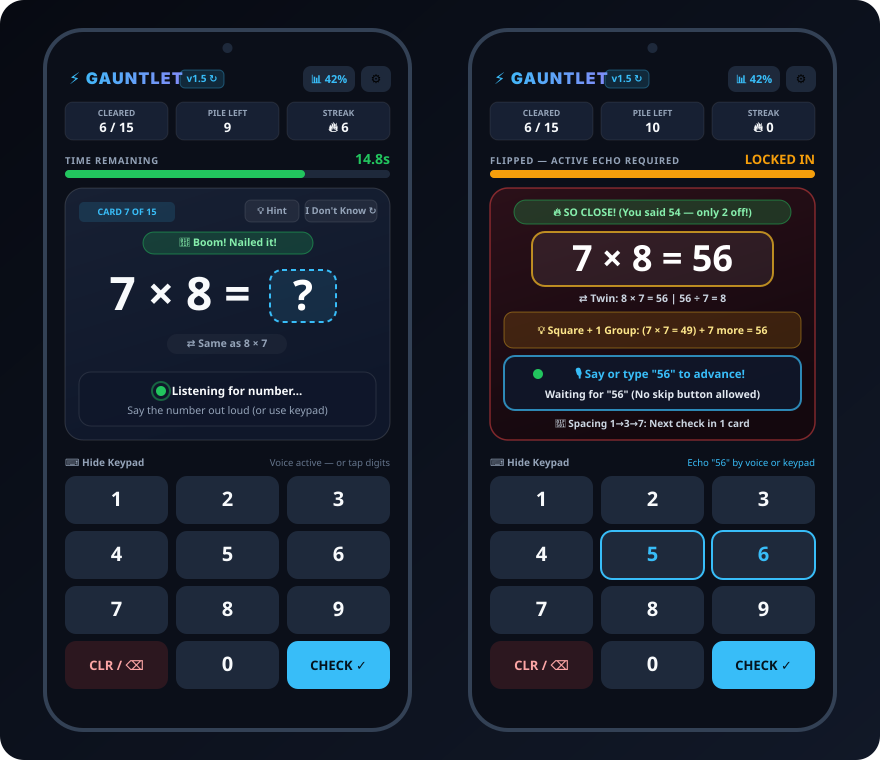

# ⚡ Tutor — Multiplication Gauntlet (PWA)

[](https://lodebek.github.io/Tutor/)
[](#architecture--tech-stack)
[-22c55e?style=for-the-badge)](#hands-free-voice-engine-web-speech-api--zero-api-keys)
[-10b981?style=for-the-badge)](#automated-unit-tests)
[](LICENSE)

**Tutor** is a mobile-first Progressive Web App (PWA) built for rapid, high-retention skill mastery on a phone. Its flagship module, **Multiplication Gauntlet**, drills all **144 multiplication facts (`1 × 1` through `12 × 12`)** using hands-free voice recognition with a final-answer confirmation loop, strict countdown timers, 3D flashcard flips, stepping-stone mental math tricks, commutative fact compression, and research-backed active retrieval.

👉 **Launch Live on Mobile or Desktop:** **[https://lodebek.github.io/Tutor/](https://lodebek.github.io/Tutor/)**



---

## 🎯 Project Goals

Traditional flashcards fail because kids either guess wildly, stare passively at the answer, or mash "Next" without encoding the fact. **Multiplication Gauntlet** was designed and iteratively refined around five goals:

1. **Zero-Friction Mobile Delivery**: Instant access via GitHub Pages with a Network-First Service Worker so code updates go live on a phone with a single refresh (or tap on the version badge).
2. **Hands-Free Voice + Final-Answer Confirmation Loop**: Let students answer naturally out loud—immediately pausing the question timer when a spoken number is heard and asking *"Is your final answer 20?"* (with a 10-second auto-submit countdown) to eliminate speech-recognizer mishearing bias.
3. **Eliminate Passive Skipping ("Locked Active Echo")**: Remove the "Next Card" skip button on missed cards. Lock the UI while the app speaks the correction, then require the student to **say or type the correct answer while looking at the full equation** before the next card unlocks.
4. **Replace Brute-Force Memorization with Number Sense**: Pair missed facts with **Stepping-Stone Mental Math Tricks**, **Commutative Twin Mastery** (mastering `7 × 8` automatically credits `8 × 7`), and **Fact Family missing-factor questions** (`7 × ? = 56`).
5. **Extensible, Tested Foundation**: Pure, unit-tested state and speech-parsing functions built with zero external runtime dependencies.

---

## 🧠 Research-Backed Learning Mechanics

### 1. Locked Failure Readout & Mandatory Active Echo
When an answer is wrong or the countdown timer expires:
- The screen flashes red (`#ff0000`) and flips the 3D flashcard to reveal the full equation (`7 × 8 = 56`).
- **UI Lock + Acoustic Tail Guard**: The keypad and microphone lock while `window.speechSynthesis` speaks the feedback and equation aloud. The engine actively polls `speechSynthesis.speaking` and waits an extra `250ms` acoustic tail buffer after speech ends so slow voices are never cut off and the microphone never hears the phone's own speaker.
- **Active Echo to Unlock**: Once the voice finishes, the microphone and keypad unlock. There is **no "Next Card" button**—the student must **say `"56"` out loud or type `56`** while viewing the equation to advance.

### 2. 3-Tier Proximity Coaching (Distance-Aware Feedback)
Instead of generic "Wrong!" messages, the engine measures how close a wrong answer is relative to the larger factor of the equation (`factorStep = Math.max(a, b)`):
- **Tier 1 — Within $\le 1\times$ Factor (e.g., off by $\le 9$ on $3 \times 9 = 27$)**:
  - **Banner**: `🔥 SO CLOSE! (You said 24 — only 3 off!)`
  - **Voice**: Supportive encouragement (*"Ooh, you're so close! Nice try!"*, *"Almost had it!"*).
- **Tier 2 — Between $1\times$ and $2\times$ Factor (e.g., off by $10\text{–}18$ on $3 \times 9 = 27$)**:
  - **Banner**: `⚡ COME ON, YOU CAN DO BETTER!`
  - **Voice**: Challenging nudge (*"Come on, you can do better than that!"*, *"You're a couple groups off—focus up!"*).
- **Tier 3 — Over $2\times$ Factor Off (e.g., off by $> 18$)**:
  - **Banner**: `🎯 WAY OFF — WE CAN DO BETTER!`
  - **Voice**: Reset coaching (*"Whoa, way off! Let's try again, we can do better!"*).

### 3. Stepping-Stone Mental Math Tricks (`💡`)
Every flipped card (and the front-side `💡 Hint` button) displays a 1-line **Derived Fact Strategy** tailored to that specific pair:
- **Square + 1 Group (Neighbors)**: For $7 \times 8 \rightarrow$ `💡 Square + 1 Group: (7 × 7 = 49) + 7 more = 56`
- **$10\times$ Step-Back (for $9\text{s}$)**: For $9 \times 7 \rightarrow$ `💡 10× Step-Back: (10 × 7 = 70) − 7 = 63 (Digits 6+3=9)`
- **$12\times$ Split ($10 + 2$)**: For $12 \times 7 \rightarrow$ `💡 12s Split (10 + 2): (10 × 7 = 70) + (2 × 7 = 14) = 84`
- **$5\times$ Stepping Stone (for $6\text{s}$)**: For $6 \times 8 \rightarrow$ `💡 5× Stepping Stone: (5 × 8 = 40) + 8 more = 48`
- **Doubling Ladders ($2\times, 4\times, 8\times$)**: Double once, twice, or three times.

### 4. Commutative Fact Synchronization ("True 36 Pairs" & "🔥 Boss 15")
- **Unified Commutative Mastery**: Because $7 \times 8$ and $8 \times 7$ are the same underlying mathematical fact, hits and misses on `a × b` automatically synchronize with `b × a` across the 12 × 12 Mastery Grid and all deck presets.
- **Commutative Twin Badge**: Displays `⇄ Same as 8 × 7` on the front and the inverse division fact (`56 ÷ 7 = 8`) on the back.
- **Deck Presets**:
  - **All (1–12)**: Full 144-card grid.
  - **True 36 Pairs**: Deduplicated commutative pairs across core factors ($3\text{–}9, 12$).
  - **🔥 Boss 15**: The 15 hardest 4th-grade facts ($6\times6, 6\times7, 6\times8, 6\times9, 6\times12, 7\times7, 7\times8, 7\times9, 7\times12, 8\times8, 8\times9, 8\times12, 9\times12, 11\times12, 12\times12$) responsible for ~80% of student errors.
  - **Core (3–12)**, **Hard (6–12)**, **Needs Work** (deduplicated weak facts weighted by lowest mastery), and **Custom Factor Toggles**.

### 5. Progressive `1 → 3 → 7` Expanding Retrieval Spacing
Based on Bjork & Landauer's expanding retrieval research, missed cards enter a 3-stage spacing ladder within the round:
1. **Retry 1/3**: Re-tested **1 card later** while still fresh in short-term memory.
2. **Retry 2/3**: Re-tested **3 cards later**.
3. **Retry 3/3**: Re-tested **7 cards later** to verify consolidation.
*(If a student misses a Stage 2 or Stage 3 retry card, the card back explicitly alerts them: `🔁 Ladder Reset (was 2/3) → Back to Step 1/3 (in 1 card)`).*

### 6. Fact Families / Missing-Factor Mode (`7 × ? = 56`)
Switch between **Standard (`7 × 8 = ?`)**, **Mixed Family**, and **Missing Factor (`7 × ? = 56`)** directly from the lobby screen to wire multiplication and division together.

---

## 🎙️ Hands-Free Voice Engine (Web Speech API / Zero API Keys)

- **Native Browser Speech APIs (Zero Paid Backend / Zero API Keys)**: Uses `window.SpeechRecognition` / `webkitSpeechRecognition` for speech-to-text and `window.speechSynthesis` for text-to-speech.
  - *Architecture & Privacy Note*: While this app requires zero API keys, zero server infrastructure, and zero third-party SDKs, browser `SpeechRecognition` implementations on Chrome/Android and iOS Safari stream audio to the browser vendor's cloud ASR servers (Google or Apple) rather than running an offline model on-device.
- **Voice Final-Answer Confirmation Loop (`"Is your final answer 20?"`)**:
  - As soon as a spoken number is captured (e.g., `20` on $4 \times 5$), the **question countdown timer immediately stops** so the student never loses question time.
  - The app asks aloud: **"Is your final answer 20?"** and starts a **10-second confirmation timer**.
  - **Confirm**: Say *"Yes"*, *"Yeah"*, *"Yep"*, *"Final answer"*, repeat *"20"*, or tap `✅ Yes (20)`.
  - **Correct Directly**: Say a different number (e.g., *"No, 56"* or *"56"*) to immediately update the candidate to `56`.
  - **Cancel**: Say *"No"* / *"Wait"* or tap `🔄 No, Change` to resume the question timer.
  - **10-Second Auto-Submit**: If the 10-second confirmation timer expires with no further input, the app automatically submits the captured best-guess number (`20`).
- **Homophone-Free Vocabulary**: Common conversational homophones (`to`, `too`, `for`, `won`, `free`, `ate`, `oh`) are excluded from the number map so phrases like *"wait for it"* or *"I'm going to..."* are never misclassified as `4` or `2`.
- **Word + Digit Question-Echo Stripping**: Strips repeated questions in digit form (`"7 times 8"`), word form (`"seven times eight is..."`), commutative order (`"eight times seven"`), missing-factor form (`"seven times what is fifty six"`), and partial mid-thought repeats (`"seven times..."`) so students are never penalized for thinking out loud.

---

## 🧪 Automated Unit Tests

Core logic in [`app.js`](app.js) is exported as pure functions and tested using Node's built-in test runner ([`tests/gauntlet.test.js`](tests/gauntlet.test.js)) with zero external dependencies:

```powershell
node --test tests/gauntlet.test.js
```

**Test Suites Covered (24 tests):**
1. **Homophone & Filler Speech Immunity** (`"wait for it"`, `"I'm going to"`, `"oh man"` $\rightarrow$ `[]`)
2. **Question-Echo Stripping** (digits, spoken words, commutative order, partial echoes, and missing-factor echoes)
3. **Paused Compound Numbers & Child-Friendly Debounce** (`"fifty ... six"` $\rightarrow 56$, extended decade/hundred prefix settle windows)
4. **Commutative Mastery Synchronization** (`7×8` and `8×7` hit/miss sync + legacy stat migration)
5. **`1 → 3 → 7` Expanding Spacing Queue** (stage 1/2/3 graduation + explicit ladder reset messaging)
6. **3-Tier Proximity Coaching & Mental Math Tricks**
7. **Voice Final-Answer Confirmation Loop** (`"yes"` / repeating `"20"` confirm, `"no 56"` candidate update, `"no wait"` cancel, and 10s auto-submit timeout)

---

## 🛠️ Evolution & Development Steps

1. **`v1.0` — Initial Gauntlet Prototype**:
   - Built the static HTML5/CSS3/JS PWA covering all 144 multiplication facts (`1 × 1` to `12 × 12`), 20-second countdown bar, 3D card flip, `#ff0000` penalty flash, auto-engaged microphone, optional on-screen keypad, and `localStorage` 12 × 12 Mastery Matrix.
2. **`v1.1` — Learning Timer & Instant Mobile Cache-Busting**:
   - Added a **1-Minute (`60s`) Learning Timer** (`1m Learn`) directly on the lobby screen alongside `10s`, `15s`, `20s`, and `30s`, plus one-tap PWA cache clearing via the header version badge.
3. **`v1.2` — Extended Reveal Timing**:
   - Doubled the post-speech viewing hold on missed cards after live testing showed the default transition moved too quickly.
4. **`v1.3` — Cognitive Science & Number Sense Upgrade**:
   - Added **Active Echo**, **Stepping-Stone Mental Math Tricks (`💡`)**, **Commutative Twin badges**, **True 36 Pairs** & **🔥 Boss 15** decks, **`1 → 3 → 7` Expanding Retrieval Spacing**, and **Missing-Factor Fact Families (`7 × ? = 56`)** with full UI controls.
5. **`v1.4` — Anti-Skip UI Lock, Proximity Coaching & Varied Praise**:
   - Removed the "Next Card" skip button on flipped cards, added a strict **UI & Keypad Lock** during failure audio playback, and introduced **3-Tier Proximity Feedback** and 16+ varied voice compliments.
6. **`v1.5` — QA Hardening, Commutative Sync & Unit Test Suite**:
   - Removed conversational homophones (`to`, `for`, `won`, `ate`, `free`, `oh`) from speech parsing, added word-form + commutative question-echo stripping, synchronized mastery tracking per commutative fact (`7 × 8` $\leftrightarrow$ `8 × 7`), added TTS `speechSynthesis.speaking` polling + `250ms` acoustic tail buffer, and added `node:test` unit tests.
7. **`v1.6` — Voice Final-Answer Confirmation Loop**:
   - Added the **Voice Confirmation Loop**: immediately pauses the question countdown timer when a number is heard, asks *"Is your final answer 20?"*, accepts *"Yes"* / repeating *"20"* / saying a corrected number / *"No"*, and auto-submits the best-guess candidate after a 10-second confirmation countdown if no further response is given.

---

## 📂 Architecture & Tech Stack

- **Environment**: 100% Static HTML5 / CSS3 / Vanilla JavaScript (zero external dependencies, zero build step, zero backend).
- **Files**:
  - [`index.html`](index.html) — Mobile viewport shell, Lobby controls, 3D Flashcard stage, Keypad, 12 × 12 Mastery Grid modal, and Settings sheet.
  - [`style.css`](style.css) — Portrait-optimized dark mode UI, 3D perspective card flip (`rotateY(180deg)`), countdown animations, and locked-state styling.
  - [`app.js`](app.js) — Game state machine, spoken number parser, Web Speech API coordinator, mental math trick generator, 3-tier proximity evaluator, and `1 → 3 → 7` spacing queue.
  - [`tests/gauntlet.test.js`](tests/gauntlet.test.js) — Automated Node.js unit test suite (`node --test`).
  - [`sw.js`](sw.js) & [`manifest.json`](manifest.json) — Installable PWA configuration with Network-First fetching.
  - [`assets/app-preview.svg`](assets/app-preview.svg) — Dual-phone vector preview of Question and Flipped Active Echo states.

---

## 👤 Creator & Maintainer

- **John Van Straalen ([@Lodebek](https://github.com/Lodebek))** — Creator, Product Design, QA & Architecture

## ⚖️ License

This project is licensed under the **[MIT License](LICENSE)** — Copyright (c) 2026 John Van Straalen ([@Lodebek](https://github.com/Lodebek)).
